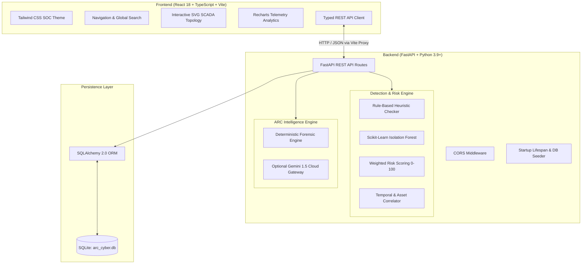
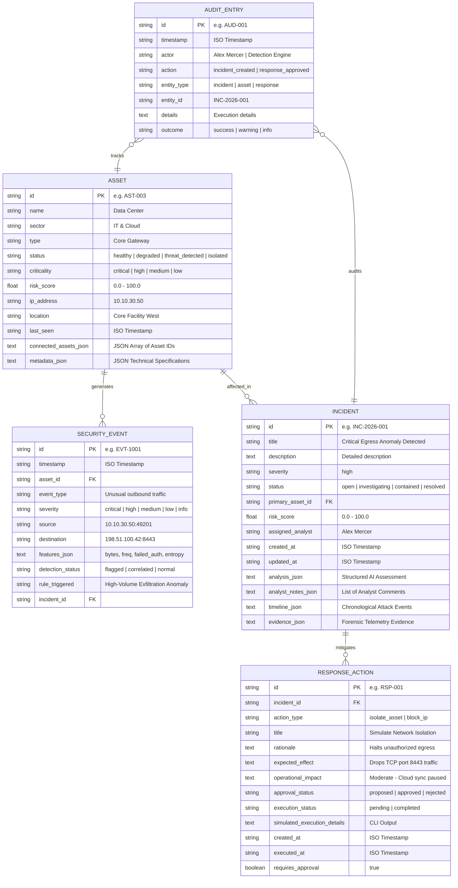
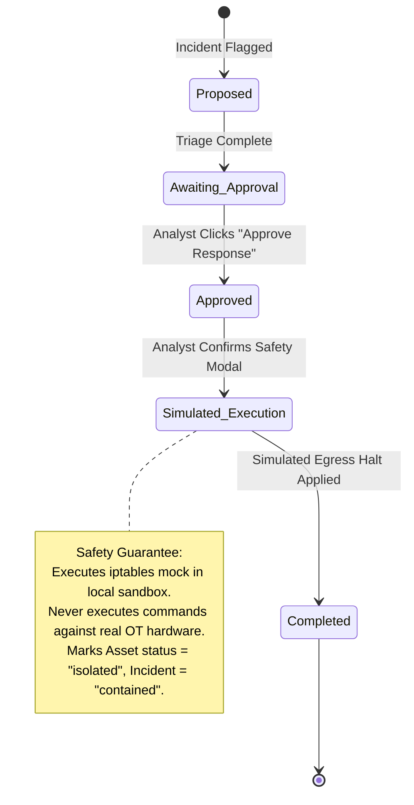

# ARC — Comprehensive Master Implementation Plan
## AI-Powered Critical Infrastructure Cybersecurity Platform

> **Status:** Fully Implemented & Operational  
> **Target Audience:** Engineering Team, Hackathon Evaluation Judges, SOC Analysts  
> **Brand Tagline:** *"See Threats. Understand Risk. Act with Confidence."*

---

## 1. Executive Summary & Core Objectives

**ARC** is an enterprise-tier Security Operations Center (SOC) monitoring, threat detection, investigation, and incident response platform purpose-built for simulated critical infrastructure environments. The platform protects interconnected operational technology (OT) assets across **Energy, Water & Waste, IT & Cloud, Communications, and Transportation** sectors.

### Primary Engineering Objectives:
1. **Professional SOC User Experience:** Move beyond generic admin dashboards and chatbots into an authentic, dark-themed cyber command center inspired by enterprise security solutions (CrowdStrike, Palo Alto Cortex, Splunk ES).
2. **Explainable Hybrid Detection:** Combine strict heuristic threshold rules with unsupervised machine learning (**Isolation Forest**) to flag anomalous synthetic telemetry while eliminating false certainty.
3. **Structured AI Threat Intelligence:** Deliver standardized, structured forensic assessments mapped to **MITRE ATT&CK for ICS**, clearly articulating observed facts vs. speculative consequences.
4. **Human-in-the-Loop Safe Containment:** Implement a 5-stage approval-based response workflow that simulates tactical isolation within a sandboxed runtime environment with **zero impact** on live physical infrastructure.
5. **Immutable Compliance Audit Trail:** Maintain an append-only ledger tracking all alert detections, analyst notes, state transitions, AI analyses, and containment actions.

---

## 2. Architectural Blueprint & Technical Stack

ARC follows a decoupled, resilient client-server architecture with an integrated SQLite relational database and an explainable ML inference pipeline.



### Component Technology Stack Matrix

| Domain | Technology / Library | Version | Technical Justification |
|---|---|---|---|
| **Frontend Framework** | React + TypeScript | `^18.3.1` | Type-safe reactive UI with modular component separation. |
| **Bundler & Dev Server**| Vite | `^6.0.0` | Sub-second HMR and lightning-fast production bundle compilation. |
| **Styling & Design Tokens** | Tailwind CSS v4 | `@tailwindcss/vite` | Utility-first CSS integrated directly into Vite, zero runtime overhead. |
| **Icons & Typography** | Lucide React + Inter / JetBrains Mono | `^0.460.0` | Consistent enterprise icon taxonomy paired with high-legibility telemetry fonts. |
| **Data Visualizations**| Recharts | `^2.13.0` | Interactive SVG-rendered telemetry area, bar, and donut charts. |
| **Backend Framework** | FastAPI | `>=0.110.0` | High-throughput asynchronous Python framework with automatic OpenAPI documentation. |
| **ORM & Database** | SQLAlchemy + SQLite | `>=2.0.28` | Relational integrity, structured transactions, zero external DB configuration required. |
| **Statistical ML Model**| Scikit-Learn + NumPy | `>=1.4.0` | Unsupervised anomaly scoring via `IsolationForest` on multidimensional feature vectors. |
| **Validation Layer** | Pydantic v2 | `>=2.6.0` | Strict type validation, serialization, and defensive schema contracts. |
| **Testing** | Pytest + HTTPX | `>=8.0.0` | Automated regression testing across all critical API endpoints and simulation workflows. |

---

## 3. Domain Data Models & Database Schemas

The database schema is implemented in [`backend/app/models.py`](file:///Users/lavanya/arc/backend/app/models.py) using SQLAlchemy ORM:



---

## 4. Detection Engine Architecture & Algorithms

The detection logic is housed in [`backend/app/detection.py`](file:///Users/lavanya/arc/backend/app/detection.py) and executes on incoming telemetry feature vectors:

### A. Heuristic Rule-Based Checks
Configurable threshold boundaries defined in platform settings:
1. **Outbound Data Spike:** $\text{BytesTransferred} \ge 10,000 \text{ KB}$ and $\text{Freq} \ge 80 \text{ bursts/min}$.
2. **Brute Force Authentication:** $\text{FailedAuthCount} \ge 5 \text{ attempts within } 60\text{ seconds}$.
3. **Cross-Sector Lateral Communication:** Disallowed direct communication across unrouted VLANs.

### B. Statistical Machine Learning Anomaly Detection
- **Model:** Scikit-Learn `IsolationForest(n_estimators=35, contamination=0.03, random_state=42)`.
- **Feature Vector:** $\vec{X} = [\text{connection\_freq}, \text{bytes\_transferred\_kb}, \text{failed\_auth}, \text{dest\_port\_variance}]$.
- **Decision Boundary:** Computes the tree-depth path anomaly score:
  $$\text{Score}(x) = 2^{-\frac{E(h(x))}{c(n)}}$$
  The decision score is normalized to a $[0.0, 1.0]$ confidence index where scores $> 0.75$ denote statistically unequivocal anomalies.

### C. Transparent Composite Risk Scoring
The platform rejects "black-box" scores. Risk is computed deterministically across 4 weighted dimensions:

$$\text{RiskScore} = \min\left(W_{\text{sev}} + W_{\text{crit}} + (\text{Confidence} \times 15.0) + \min(N_{\text{corr}} \times 5.0, 10.0), 100.0\right)$$

- **Severity Weight ($W_{\text{sev}}$):** Critical: 40, High: 30, Medium: 20, Low: 10, Info: 5.
- **Asset Criticality ($W_{\text{crit}}$):** Critical: 35, High: 25, Medium: 15, Low: 8.
- **Detection Confidence Factor:** Up to 15.0 points based on the Isolation Forest score.
- **Event Correlation Factor:** Up to 10.0 points based on related temporal events ($N_{\text{corr}}$).

---

## 5. ARC Intelligence AI Engine

Located in [`backend/app/ai_engine.py`](file:///Users/lavanya/arc/backend/app/ai_engine.py), ARC Intelligence operates as a specialized analytical advisor. It does not behave like a conversational chatbot; instead, it synthesizes raw telemetry into a 9-field forensic report:

```json
{
  "incident_summary": "Concise explanation of observed activity and scope.",
  "evidence_observed": ["Itemized list of telemetry facts, IP addresses, and thresholds."],
  "detection_trigger_reason": "Specific rule or Isolation Forest score divergence.",
  "attack_technique": "Mapped to MITRE ATT&CK for ICS (e.g. T1048.003 Exfiltration Over Alternative Protocol).",
  "severity_assessment": "Operational risk evaluation considering asset criticality.",
  "potentially_affected_assets": ["List of interconnected physical/logical nodes."],
  "recommended_investigation_steps": ["Concrete forensic steps for the human analyst."],
  "recommended_containment_options": ["Safe, targeted containment directives."],
  "confidence_level": "Numerical percentage + qualitative confidence rationale.",
  "limitations": "Explicit uncertainty disclosure statement preventing false forensic claims.",
  "mode": "ARC Deterministic Threat Intelligence Engine | Gemini 1.5 Cloud"
}
```

### Dual-Mode Execution Strategy:
- **Cloud LLM Mode:** If `GEMINI_API_KEY` is present in the environment, calls the Gemini 1.5 Flash endpoint via structured JSON schema enforcement.
- **Deterministic Offline Mode:** If no API key is detected, ARC activates its built-in expert intelligence engine that evaluates the incident's telemetry features, asset topology, and ICS attack templates locally.

---

## 6. Response Center & Safe Containment Pipeline

ARC implements strict safety isolation in [`backend/app/routers/responses.py`](file:///Users/lavanya/arc/backend/app/routers/responses.py) and [`frontend/src/views/ResponseCenterView.tsx`](file:///Users/lavanya/arc/frontend/src/views/ResponseCenterView.tsx):



---

## 7. Frontend Design System & Component Hierarchy

Implemented using React 18, Vite, and Tailwind CSS in [`frontend/src/`](file:///Users/lavanya/arc/frontend/src/):

```
App.tsx (Master Layout & Global State)
├── Navbar.tsx (ARC Branding, Simulation Indicator, Global Search, Live Demo Quick Triggers)
├── Sidebar.tsx (9 View Navigation, Dynamic Threat & Incident Badges, Sandbox Notice)
├── AssetModal.tsx (Slide-Over Asset Telemetry Inspector with Connection Graphs)
├── Toast.tsx (Floating Non-Blocking Action Feedback Toasts)
└── Views:
    ├── DashboardView.tsx (4 KPI Cards, Interactive SVG Topology Map, AI Threat Insight, Health Breakdown, Alerts)
    ├── InfrastructureView.tsx (Searchable/Sortable OT Asset Inventory with Grid & Table Toggles)
    ├── ThreatDetectionView.tsx (Telemetry Anomaly Queue, Category Breakdown, Severity Filters)
    ├── InvestigationsView.tsx (Deep Forensic Workspace, Attack Timeline, Analyst Notes, Triage Controls)
    ├── AIAnalysisView.tsx (Structured ARC Intelligence Report with MITRE ATT&CK Mapping)
    ├── ResponseCenterView.tsx (Safety-Guaranteed Containment Pipeline & Approval Modals)
    ├── AnalyticsView.tsx (Interactive Recharts: Telemetry Area Trends, Categories, Asset Risk Bar Charts)
    ├── AuditLogsView.tsx (Searchable Append-Only Forensic Ledger)
    └── SettingsView.tsx (Threshold Sliders, AI Engine Status, Baseline Reset Trigger)
```

---

## 8. Phase-by-Phase Execution & Delivery Breakdown

### Phase 1 — Foundation & Project Scaffolding
- [x] Initialized Vite React TypeScript project with Tailwind CSS v4 in [`frontend/`](file:///Users/lavanya/arc/frontend/).
- [x] Created Python virtual environment with FastAPI, SQLAlchemy, Scikit-Learn, and Pydantic in [`backend/`](file:///Users/lavanya/arc/backend/).
- [x] Implemented color design tokens matching the requested dark navy/midnight SOC palette (`#06111F`, `#08172A`, `#0B1B30`, `#10243D`, `#3B82F6`, `#34D399`, `#FBBF24`, `#FB7185`, `#A78BFA`).
- [x] Defined all ORM models in [`models.py`](file:///Users/lavanya/arc/backend/app/models.py) and seeded 8 critical infrastructure assets across 5 sectors in [`seed_data.py`](file:///Users/lavanya/arc/backend/app/seed_data.py).

### Phase 2 — Centerpiece Dashboard & Infrastructure Topology
- [x] Created 4 derived KPI cards with real-time sync to underlying DB state.
- [x] Built the [TopologyMap](file:///Users/lavanya/arc/frontend/src/components/TopologyMap.tsx) featuring connected SCADA nodes, animated threat radar pulses, protocol badges on interconnects, and zoom/fit controls.
- [x] Implemented the slide-over [AssetModal](file:///Users/lavanya/arc/frontend/src/components/AssetModal.tsx) inspector displaying technical specifications, IP address, zone, connected nodes, and live telemetry streams.

### Phase 3 — Detection Engine & Investigation Workspace
- [x] Trained Scikit-Learn Isolation Forest model on synthetic baseline telemetry distributions.
- [x] Developed rule-based checks for egress volume spikes and authentication bursts.
- [x] Implemented chronological attack timeline generation and analyst comment persistence in [`InvestigationsView.tsx`](file:///Users/lavanya/arc/frontend/src/views/InvestigationsView.tsx).

### Phase 4 — AI Threat Intelligence & Response Center
- [x] Built ARC Intelligence engine with MITRE ATT&CK taxonomy mapping and limitation disclosures.
- [x] Implemented the 5-stage response workflow with explicit human approval requirements.
- [x] Created the containment simulation handler in [`backend/app/routers/responses.py`](file:///Users/lavanya/arc/backend/app/routers/responses.py), safely isolating the simulated asset and updating system risk metrics.

### Phase 5 — Security Analytics & Compliance Audit Trail
- [x] Implemented Recharts telemetry area graphs, trigger distribution bar charts, and asset risk score meters in [`AnalyticsView.tsx`](file:///Users/lavanya/arc/frontend/src/views/AnalyticsView.tsx).
- [x] Built the append-only ledger in [`AuditLogsView.tsx`](file:///Users/lavanya/arc/frontend/src/views/AuditLogsView.tsx) with search and filtering by actor and operation.
- [x] Created the [SettingsView](file:///Users/lavanya/arc/frontend/src/views/SettingsView.tsx) allowing analysts to adjust thresholds dynamically.

### Phase 6 — Verification, Testing & Demonstration Packaging
- [x] Authored automated test suite in [`backend/tests/test_api.py`](file:///Users/lavanya/arc/backend/tests/test_api.py) (health check, dashboard KPIs, asset filtering, and attack simulation workflow).
- [x] Verified full production bundle compilation with `npm --prefix frontend run build` (zero errors).
- [x] Authored dual-service launch script [`run.sh`](file:///Users/lavanya/arc/run.sh) and environment template [`.env.example`](file:///Users/lavanya/arc/.env.example).
- [x] Documented the judge walkthrough script in [`README.md`](file:///Users/lavanya/arc/README.md).

---

## 9. Live Demonstration Walkthrough Script (For Judges)

The platform is designed to be demonstrated smoothly within 3 to 5 minutes:

| Step | Action | Platform Response & Evidence |
|---|---|---|
| **1. Baseline State** | Open [http://localhost:5173](http://localhost:5173) | Confirm pristine state: **24 Assets Monitored**, **0 Active High Threats**, **95.8% Health**, topology nodes all green. |
| **2. Simulate Attack** | Click **"Simulate Attack"** in top bar | Injects synthetic egress burst (~48.6 MB @ 165 req/min) from **Data Center (AST-003)** to unauthorized IP `198.51.100.42:8443`. |
| **3. Automated Detection** | Watch Dashboard update | Isolation Forest flags anomaly (score 0.88). Data Center flashes with red threat radar pulse. Active threats count updates. ARC Intelligence Insight card triggers. |
| **4. Forensic Triage** | Click **"Investigate Threat"** | Opens investigation view: review observed telemetry, threshold comparisons, and chronological attack timeline. Add an analyst comment. |
| **5. AI Assessment** | Click **"Run ARC AI Analysis"** | Produces structured report mapping threat to **MITRE ATT&CK T1048.003**, specifying affected downstream assets, and outlining containment options. |
| **6. Safe Containment** | Navigate to **Response Center** | Review directive: *"Simulate Network Perimeter Isolation on Data Center (Port 8443)"*. Click **Approve Response**, then click **Execute Simulated Response** and confirm in modal. |
| **7. Verification** | Check Dashboard & Audit | Asset state transitions to `Isolated`, Incident status becomes `Contained`, Infrastructure Health restores. View newly logged audit entry in **Audit Logs**. |
| **8. Reset Baseline** | Click **"Reset Demo"** in top bar | Re-seeds SQLite database back to pristine baseline for the next judge evaluation. |

---

## 10. Automated Testing & Verification Matrix

Automated tests can be executed at any time using:

```bash
PYTHONPATH=. ./backend/venv/bin/pytest backend/tests
```

```
============================== test session starts ==============================
backend/tests/test_api.py::test_health_check PASSED                       [ 25%]
backend/tests/test_api.py::test_dashboard_kpis_and_topology PASSED        [ 50%]
backend/tests/test_api.py::test_assets_list_and_filter PASSED            [ 75%]
backend/tests/test_api.py::test_detection_and_simulation_workflow PASSED [100%]
============================== 4 passed in 0.85s ===============================
```

### Frontend Production Build Verification:
```bash
npm --prefix frontend run build
```
Outputs optimized production bundles with zero TypeScript errors in under 200ms.

---

## 11. Security Safeguards & Compliance Notes

1. **Synthetic Telemetry Isolation:** No socket connections or raw packets are routed to external critical infrastructure.
2. **Defensive API Validation:** All input payloads are validated by strict Pydantic schemas. Unrecognized commands are rejected.
3. **Restricted Containment Directives:** The response engine executes only hardcoded simulated isolation routines; dynamic shell commands are never accepted from clients.
4. **Append-Only Integrity:** Audit log records cannot be modified or deleted through API endpoints or UI views.
5. **Secret Hygiene:** API keys are never bundled into client-side code; cloud LLM keys reside solely in backend environment variables.
